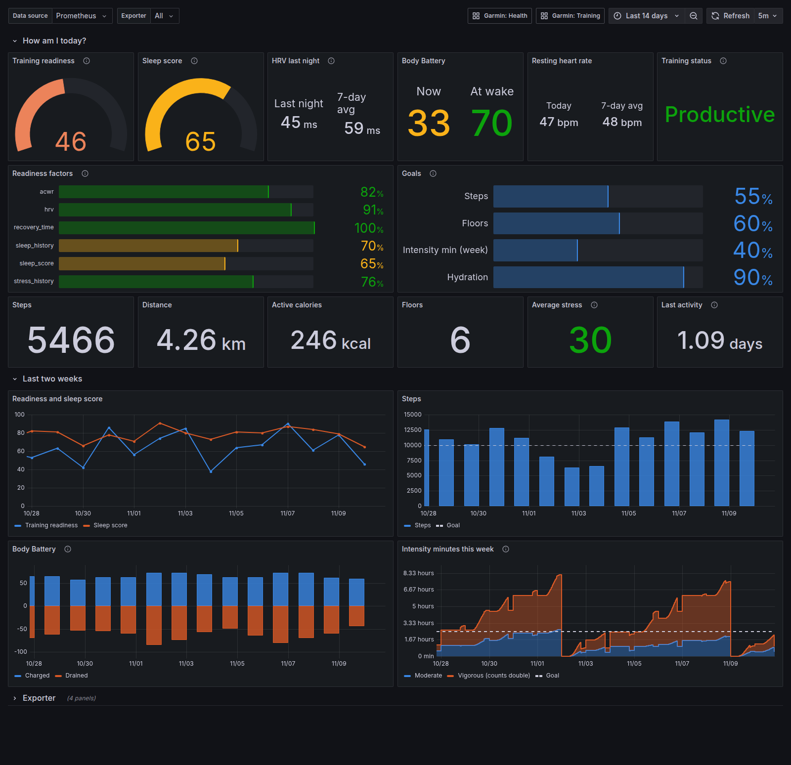
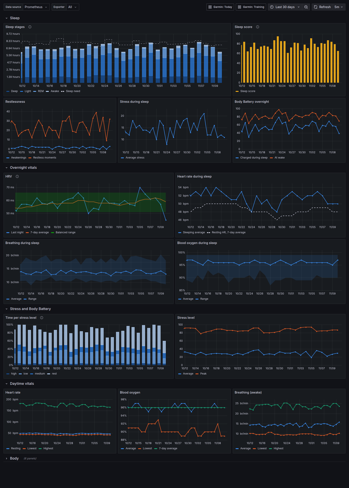
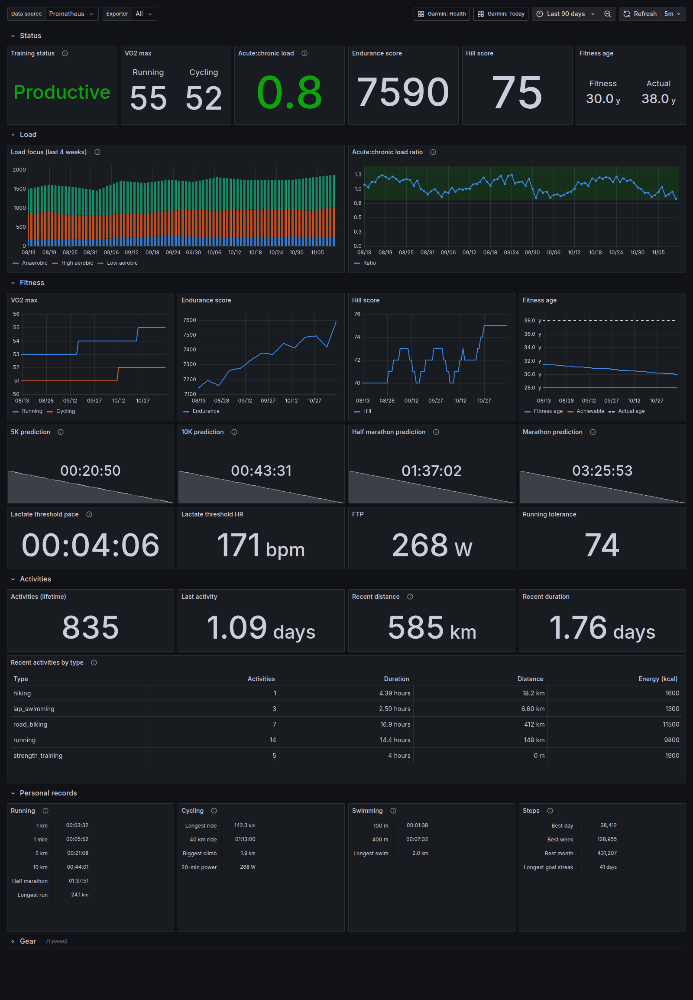

# Dashboards

Grafana dashboards for `garmin_exporter`, provisioned automatically by the
[`prometheus/`](../prometheus) and [`otlp/`](../otlp) examples.

| Dashboard                 | Shows                                                                                       |
| ------------------------- | ------------------------------------------------------------------------------------------- |
| [Today](today.json)       | Garmin's morning report: readiness, sleep, HRV, Body Battery, goals and exporter health     |
| [Health](health.json)     | Sleep, overnight vitals against your baseline, stress, daytime vitals and body measurements |
| [Training](training.json) | Training status and load, VO2 max and other fitness scores, activities and personal records |

## Today

## Health

## Training

## Import

To use them in your own Grafana, import the JSON files (Dashboards → New →
Import). Each asks for a Prometheus data source, and the **Exporter** variable
picks the `garmin_exporter` instance, so one Grafana can show several accounts.
They need garmin_exporter 2.0 or later.
